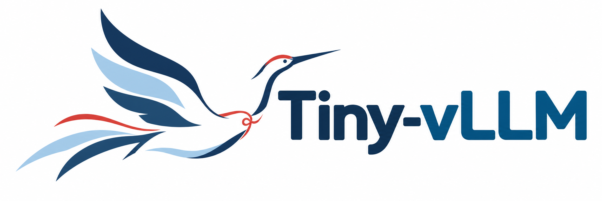
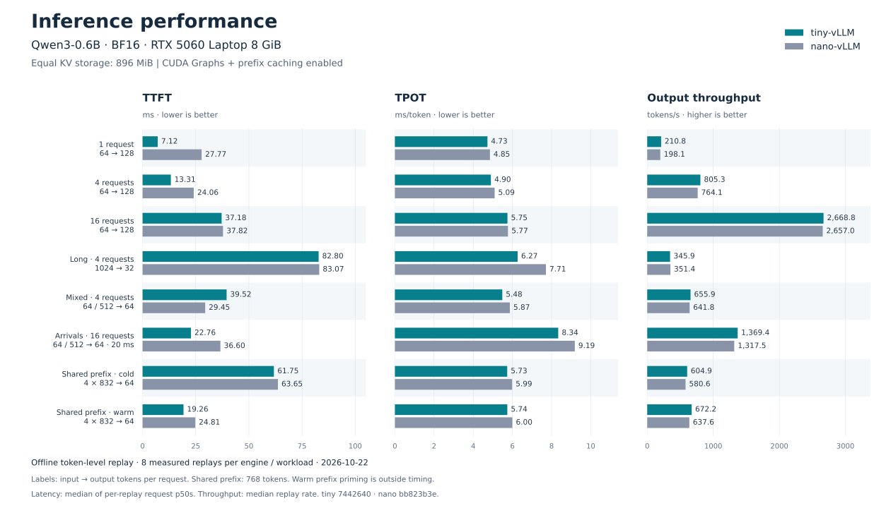
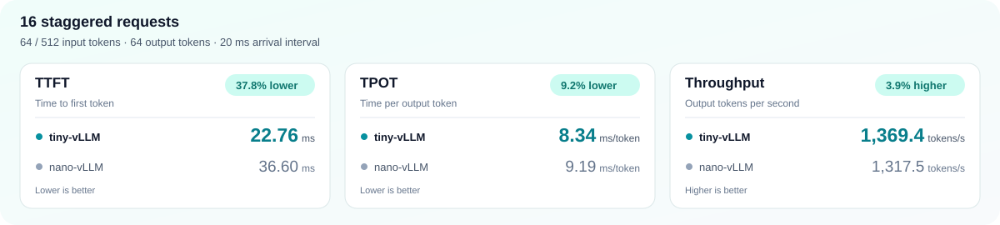
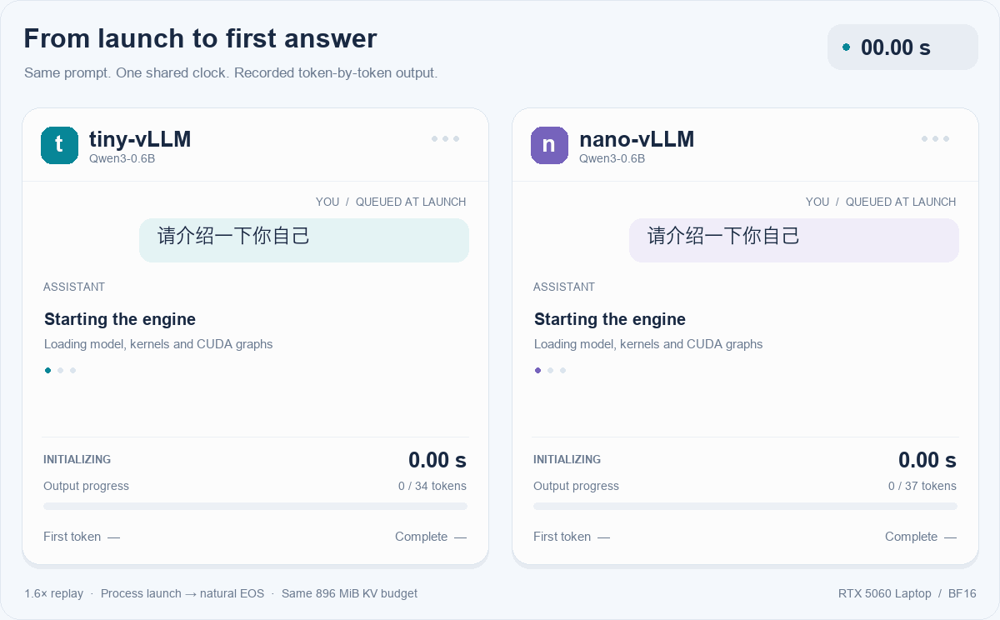
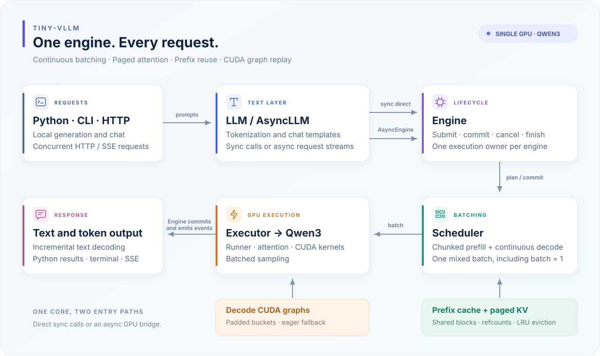

<p align="center">
  
</p>

# tiny-vLLM

[English](README.md) | **简体中文**

基于 PyTorch 与 CUDA 的轻量单 GPU 推理引擎，支持 dense Qwen3 模型。

**分页 KV · 前缀缓存 · 连续批处理 · 分块预填充 · CUDA Graph · CUDA 融合算子**

## 安装

Linux / WSL2、Python 3.11+、NVIDIA GPU 与驱动、包含 `nvcc` 的 **CUDA Toolkit 12.8**，以及兼容的 C++ 编译器。

```bash
git clone https://github.com/RicardoMin/tiny-vllm.git
cd tiny-vllm

python3.12 -m venv .venv
source .venv/bin/activate
python -m pip install --upgrade pip
python -m pip install torch==2.9.1 --index-url https://download.pytorch.org/whl/cu128
python -m pip install -e '.[kernels,server]'

# 改为本机 CUDA 12.8 Toolkit 路径。
export CUDA_HOME=/usr/local/cuda-12.8
export PATH="$CUDA_HOME/bin:$PATH"

export MODEL="$HOME/models/Qwen3/Qwen3-0.6B"
hf download Qwen/Qwen3-0.6B --local-dir "$MODEL"
```

Toolkit 版本须与 PyTorch 的 CUDA 版本一致。首次初始化会编译 CUDA 扩展，后续复用缓存。默认 CUDA 后端不依赖 FlashInfer；执行 `python -m pip install -e '.[flashinfer]'` 并指定 `--attention-backend flashinfer` 可使用可选后端。

## 使用

### Python

```python
from pathlib import Path
from tinyvllm import EngineConfig, LLM, SamplingParams

config = EngineConfig(
    model=Path.home() / "models/Qwen3/Qwen3-0.6B",
    max_model_len=2048,
    kv_cache_memory_bytes=512 * 1024**2,
)

with LLM(config) as llm:
    reply = llm.chat(
        [{"role": "user", "content": "请介绍一下你自己"}],
        SamplingParams(max_new_tokens=128),
    )
    print(reply.text)
```

批量补全使用 `llm.generate([prompt1, prompt2], sampling)`。`AsyncLLM` 提供并发生成及 `stream()` / `chat_stream()` 流式接口。最小补全示例见 [example.py](example.py)。

### 终端

```bash
# 本地多轮聊天。
python -m tinyvllm --model "$MODEL" --chat --max-new-tokens 256

# 单个 prompt 流式输出。
python -m tinyvllm --model "$MODEL" --prompt "The capital of France is" --stream
```

聊天命令：`/help`、`/reset`、`/exit`；生成期间 Ctrl-C 取消当前轮。

### HTTP

```bash
python -m tinyvllm.server --model "$MODEL" --served-model-name Qwen3-0.6B
```

在另一个终端调用：

```bash
python -m tinyvllm.chat --base-url http://127.0.0.1:8000/v1 --model Qwen3-0.6B

# 或直接请求 SSE 聊天流。
curl -N http://127.0.0.1:8000/v1/chat/completions \
  -H 'Content-Type: application/json' \
  -d '{"model":"Qwen3-0.6B","messages":[{"role":"user","content":"请介绍一下你自己"}],"max_tokens":128,"stream":true}'
```

接口：`/v1/completions`、`/v1/chat/completions`、`/v1/models`、`/health`。提供 OpenAI 风格的文本补全和 SSE，每请求生成一个结果。各 CLI 入口均可通过 `--help` 查看选项。

## 性能

**Qwen3-0.6B · BF16 · RTX 5060 Laptop 8 GiB**

### 推理吞吐与延迟







## 架构



## 致谢

[nano-vLLM](https://github.com/GeeeekExplorer/nano-vllm) · [vLLM](https://github.com/vllm-project/vllm) · [SGLang](https://github.com/sgl-project/sglang) · [PyTorch](https://pytorch.org/) · [Qwen3](https://github.com/QwenLM/Qwen3) · [Transformers](https://github.com/huggingface/transformers) · [FlashInfer](https://github.com/flashinfer-ai/flashinfer)
